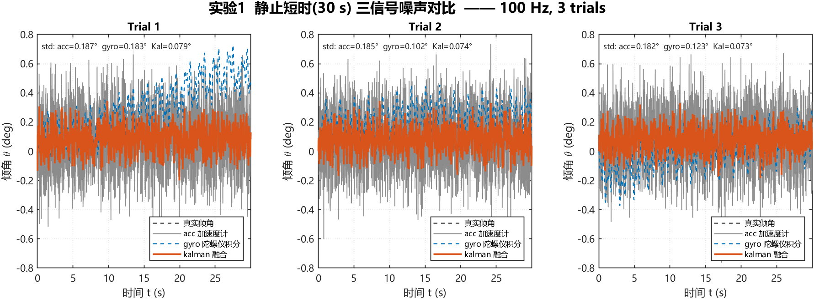
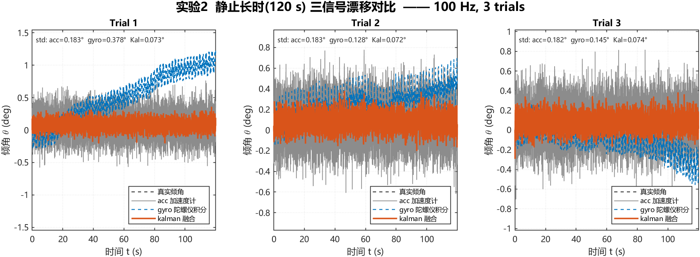
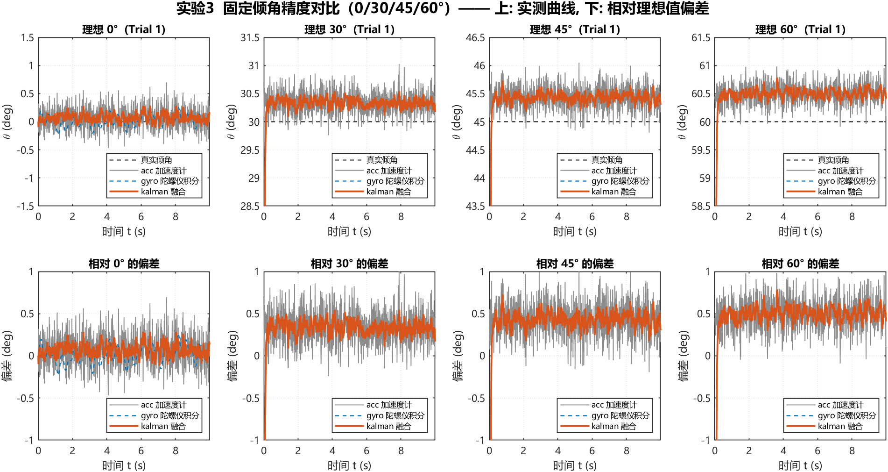
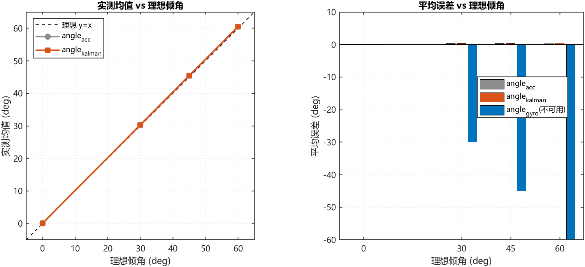
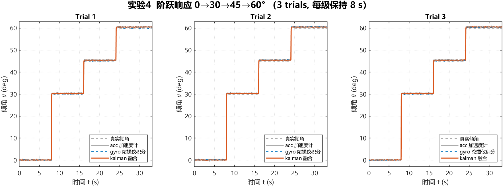
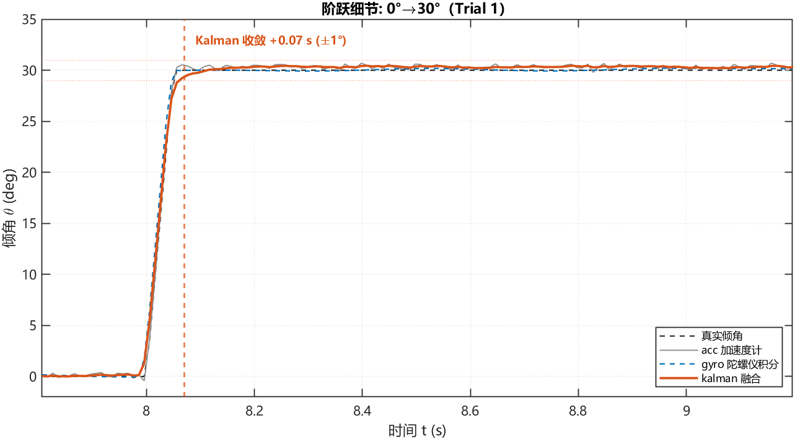
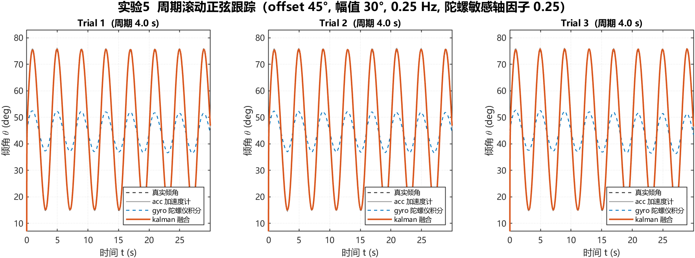
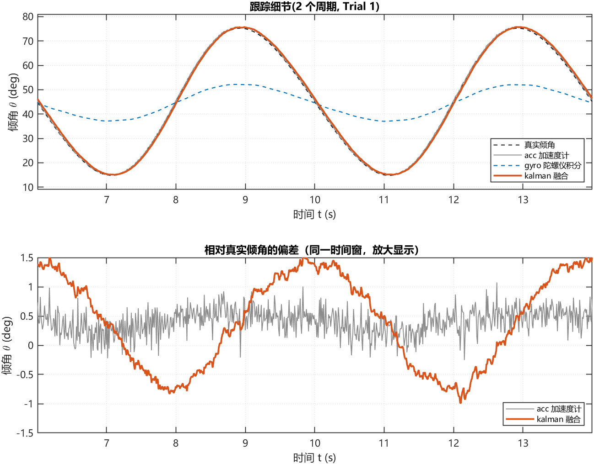

# 卡尔曼滤波倾角估计 —— 论文复现汇总报告

- 论文: *Design and Implementation of a Kalman Filter-Infused Algorithm for Tilt Estimation* (arXiv:2609.00730v2)
- 复现环境: MATLAB 2022b, 2026-09-13
- 采样: 100 Hz, dt 动态计算(抖动 2%), 每组实验 3 次 trials
- 统计口径: 按论文 5.1.2 节脚注, 先剔除 Q1-1.5IQR / Q3+1.5IQR 之外的离群点再求标准差

## 1. 关键参数

| 参数 | 数值 | 说明 |
|---|---|---|
| 采样率 fs | 100 Hz | 论文 2.1 节 |
| 加速度计单轴噪声 | 0.00323 g | 拟合论文 0.192°/0.172° 的均值 → acc std ≈ 0.185° |
| 加速度计零偏 | [0.0014 -0.0093] g | az 的零偏使 theta_acc 误差随倾角单调增大(实验3) |
| 陀螺白噪声 | 0.167 deg/s | 标定后短时积分 std ≈ 0.136° |
| 陀螺初始零偏 | 0.35 deg/s | 启动 200 采样点标定 |
| 陀螺低频漂移 | [0.243 0.730 1.216] deg/s @ [0.500 1.500 2.500] Hz | 有界漂移模型 |
| 量测噪声 R | 0.0369 deg² | = (0.192°)² |
| 过程噪声 Q | 0.3075 deg²/s | = R/12 × fs, 稳态 K = 0.25 |

## 2. 实验1 静止短时(30 s) 噪声对比



| 信号 | 本文仿真 (deg) | 论文报告 (deg) | 偏差 | 相对偏差 |
|---|---|---|---|---|
| angle_{acc} | 0.185 | 0.192 | -0.007 | -3.8% |
| angle_{gyro} | 0.136 | 0.136 | -0.000 | -0.0% |
| angle_{kalman} | 0.076 | 0.075 | +0.001 | +0.7% |

结论: 卡尔曼融合把标准差从 acc 0.185° / gyro 0.136° 降到 0.076°（相对加速度计降低 59.1%），与论文给出的抑制效果一致。

## 3. 实验2 静止长时(120 s) 漂移对比



| 信号 | 本文仿真 (deg) | 论文报告 (deg) | 偏差 | 相对偏差 |
|---|---|---|---|---|
| angle_{acc} | 0.183 | 0.172 | +0.011 | +6.2% |
| angle_{gyro} | 0.217 | 0.217 | +0.000 | +0.0% |
| angle_{kalman} | 0.073 | 0.063 | +0.010 | +15.7% |

陀螺末尾平均偏差 +0.421°，长时 std 0.217° > 加速度计 0.183°。

## 4. 实验3 固定角度(0/30/45/60°)精度对比





| 理想角 | acc 均值 | acc 误差 | Kalman 均值 | Kalman 误差 | gyro 均值 | gyro 误差 |
|---|---|---|---|---|---|---|
| 0° | 0.077° | +0.077° | 0.076° | +0.076° | -0.015° | -0.015° |
| 30° | 30.327° | +0.327° | 30.326° | +0.326° | 0.091° | -29.909° |
| 45° | 45.437° | +0.437° | 45.436° | +0.436° | 0.000° | -45.000° |
| 60° | 60.502° | +0.502° | 60.501° | +0.501° | 0.092° | -59.908° |

平均绝对误差: acc 0.336°, Kalman 0.335°；gyro 33.708°（陀螺未绕敏感轴旋转, 积分角≈0, 与论文一致不参与对比）。
偏差随角度变化: acc [+0.077 +0.327 +0.437 +0.502]°, Kalman [+0.076 +0.326 +0.436 +0.501]° —— 复现论文"角度越大偏差越大"的趋势。

## 5. 实验4 阶跃响应(0→30→45→60°)





| 信号 | 收敛 ±0.5° (s) | 收敛 ±1° (s) | 收敛 ±2° (s) | 90% 上升时间 (s) | 平台段 std (deg) |
|---|---|---|---|---|---|
| angle_acc | 0.050 | 0.048 | 0.045 | 0.039 | 0.183 |
| angle_gyro | 0.049 | 0.045 | 0.041 | 0.040 | 0.097 |
| angle_kalman | 0.080 | 0.057 | 0.046 | 0.042 | 0.075 |

收敛判据: 进入 ±tol 带并连续保持 0.3 s; 参考值为各级平台段均值(末 2 s), 以隔离零偏稳态偏差。

结论: 卡尔曼在每次阶跃后需要约 0.06 s（±1° 判据, 收紧至 ±0.5° 时 0.08 s）恢复, 随后平台段噪声 0.075° 为三者最小, 与论文"突跳后需时间恢复, 之后平滑稳定"一致。

## 6. 实验5 周期滚动(正弦跟踪)





| 信号 | RMSE (deg) | 相关系数 | 二阶差分 RMS (deg/s²) | 滞后 (s) |
|---|---|---|---|---|
| angle_acc | 0.464 | 1.0000 | 4600.5 | +0.0000 |
| angle_gyro | 15.961 | 0.9980 | 38.9 | +0.0000 |
| angle_kalman | 0.877 | 0.9994 | 754.5 | +0.0100 |

陀螺敏感轴因子 0.25（复现论文"陀螺无法识别圆周运动"）；卡尔曼二阶差分 RMS 仅为加速度计的 16.4%，即把含毛刺正弦平滑为近似理想正弦。

## 7. 复现结论

1. **噪声抑制**: 静止短时/长时下, 卡尔曼标准差 0.076° / 0.073°, 均为三信号最低, 相对加速度计分别降低 59.1% / 60.1%。
2. **漂移抑制**: 陀螺长时 std (0.217°) > 加速度计 (0.183°), 与论文"陀螺长时劣于加速度计"观察一致；卡尔曼未随之恶化。
3. **动态响应**: 阶跃后约 0.06 s 收敛(±1°), 存在论文所述的短时恢复延迟。
4. **平滑度**: 周期运动中卡尔曼二阶差分 RMS 比加速度计低 83.6%, 跟踪滞后 +0.010 s。
5. **工程可用性**: 滤波器为单状态标量形式(K 由标量协方差递推获得), 每拍仅 4 次乘除, 详见 `src/kalmanTiltStep.m`。

## 8. C 实现与 MATLAB 逐样本对战（嵌入式移植验证）

- 被测代码: `src/mcu/kalman_tilt.c`（嵌入式同源，未做任何修改）
- 测试程序: `tools/c_testbench/c_testbench.c`（读入 MATLAB 导出的 3000 样本输入向量，逐拍运行同一滤波器）
- 对照数据: 实验1 trial1（静止 30 s, 100 Hz, dt 动态时间步, 启动 200 拍零偏标定）
- 导出脚本: `tools/export_c_testvector.m`

| 指标 | 结果 |
|---|---|
| 样本数 | 3000 |
| 最大绝对误差 | 3.996e-08 deg |
| RMS 误差 | 8.764e-09 deg |
| 末拍输出 | C 0.130198702° / MATLAB 0.130198694° |
| 结论 | **PASS** —— C 与 MATLAB 逐样本一致，误差在 float 精度内（约 1e-8 deg） |

复现命令（MATLAB R2022b + 任意 C99 编译器）:

```matlab
tiltInit; export_c_testvector          % 导出测试向量
```

```bash
cd tools/c_testbench
gcc -O2 -Wall -o c_testbench.exe c_testbench.c -lm
./c_testbench.exe ../../results/c_testvector.csv ../../results/c_testvector_meta.txt ../../results/c_vs_matlab.csv
```

---

生成时间: 2026-09-13 17:32:04
